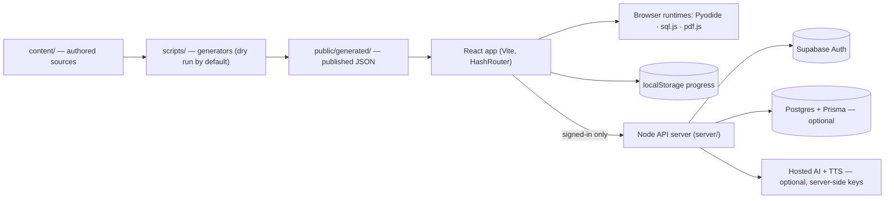

<p align="center">
  
</p>

<h1 align="center">BroCode</h1>

<p align="center">
  <strong>The complete technology learning platform.</strong><br />
  Learn the theory, run the code, practise the questions, and prepare for the interview — in one browser tab.
</p>

<p align="center">
  <a href="https://mybrocode.vercel.app/"></a>
  <a href="https://github.com/ashu018019020-collab/BroCode"></a>
</p>

<p align="center">
  
  
  
  
  
  
</p>

<p align="center">
  <a href="https://mybrocode.vercel.app/">
    
  </a>
</p>

## What is BroCode?

**BroCode** is an online learning platform for programming, data, AI/ML, and interview preparation. It pairs a structured curriculum with real, runnable environments: Python and NumPy/pandas execute in the browser through Pyodide, SQL runs on SQLite compiled to WebAssembly, and a PDF reader keeps the source material one click away.

Everything on the learning path is authored from a single 457-page AI-engineer guide, then published as data the app renders — so the chapters, questions, labs, and projects stay in sync with the material they came from.

**At a glance**

| | |
|---|---|
| Curriculum | 29 chapters across 8 learning tracks, organised as **11 courses / 36 numbered steps** |
| Question bank | **13,865** questions across 29 chapter banks (interview, coding, debug, logic, theory, solved, defense, checkpoint) |
| Drills | **476** playbook items, plus timed exams and **39** mock-interview questions in 4 rounds |
| Interview Room | 8 subjects, 6 round types, 3 difficulty levels, voice questions, answer transcription, AI evaluation, session report |
| Runtime | Python 3.12 + NumPy + pandas, SQLite, pdf.js — all bundled, no CDN |
| Language | English by default, Hinglish available |

> **An account is required.** BroCode has no guest mode. Email + password sign-in is handled by Supabase, and progress is saved locally and synced to your account.

## Quick links

| Link | What it opens |
|---|---|
| [Live demo](https://mybrocode.vercel.app/) | The deployed platform |
| [Interview Room](https://mybrocode.vercel.app/#/interview-mode) | Pick a subject, configure a round, start |
| [Practice](https://mybrocode.vercel.app/#/practice) | Tracks → chapters → question bank |
| [Question Bank](https://mybrocode.vercel.app/#/questions) | Every stored question, filterable |
| [AI Mentor](https://mybrocode.vercel.app/#/ai-mentor) | Voice-first mentor and coding coach |
| [Notebook Lab](https://mybrocode.vercel.app/#/notebooks) | Jupyter notebooks on the bundled Python runtime |
| [Career](https://mybrocode.vercel.app/#/career) | Job-readiness gates, resume answers, next action |
| [Docs](docs/) | Architecture, security, authentication, content pipeline, voice |

## What you can do

| Area | What is actually there |
|---|---|
| **Learn** | 36 steps numbered across 11 courses; each step carries concepts, interview Q&A, coding/debug/logic tasks, mini projects, a project lab, checkpoints, and mastery gates |
| **Practise** | The 13,865-question bank is the single source: the Question Bank, section lists, stage tiles, mistake tracker, and the Interview Room all read the same records, so an answer marked in one place is marked everywhere |
| **Run code** | A VS Code-style playground (Monaco + Pyodide), Jupyter notebooks with a shared kernel per notebook, a SQL lab on sql.js, and a full PDF reader — with traceback parsing and a teaching card instead of a raw stack trace |
| **Interview** | Voice-enabled rounds with real AI evaluation, corrective teaching, and a report built from the answers you actually gave |
| **Career** | Readiness is measured from real records — stage gates, resume answers, checklist ticks, project defenses — not from a self-rating |
| **Ask** | The AI mentor retrieves from the bundled curriculum and cites where its answer came from; it works without any API key. Optional hosted voice and evaluation are labelled where they appear |
| **Track progress** | XP, levels, streaks, daily mission, spaced review, mistakes, notes, bookmarks — stored locally, synced to your account, exportable as JSON |

## The Interview Room

The Interview Room is the part that behaves most like a real interview, so its rules are explicit:

1. **Pick a subject** — Python Core, NumPy + Pandas, SQL, ML + NLP, GenAI, Agentic AI, APIs + Production, or Interview + Projects. Each card opens its own setup screen, not a filtered copy of the hub.
2. **Configure the round** — Technical, Coding, Project-Based, HR, Mock, or Timed; Beginner, Intermediate, or Advanced; 3, 5, 10 questions, or **All Questions**.
3. **Answer** — type, or dictate with the microphone. The transcript lands in an editable box; nothing is submitted for you, and a partial answer is never auto-sent.
4. **Get marked** — the evaluator returns a structured verdict: score, status (correct / partially correct / incorrect / needs clarification), technical accuracy, concepts you showed, concepts missing, specific mistakes, evidence quoted from your answer, an explanation, an improved model answer, a next step, and a follow-up.
5. **Hear the correction** — the question and the feedback are spoken with the best available female voice (Google Neural2 when the server key is configured, otherwise the best browser voice). Speed and English/Hinglish are selectable.
6. **Finish with a report** — overall score, answered vs planned, correct/partial/incorrect, accuracy, per-topic averages, strongest and weakest topics, revision concepts, practice recommendations, and every answer expandable for review.

**All Questions means all of them.** The setup screen shows how many stored questions match the round type; when the round starts, every chapter bank in the subject is loaded, the exact eligible set for your level is measured, de-duplicated by question id, and tracked to the end. A round never stops silently after five questions. If a subject has nothing for that combination, the room says so and offers recovery instead of inventing a question. AI follow-ups are shown as follow-ups and never replace a required question.

**Honest boundaries**

- AI evaluation needs `OPENAI_API_KEY` on the server. Without it the room still works and labels the result **Built-in rubric** — it does not pretend a model marked you.
- Speech recognition uses the browser's Web Speech API. It is available in Chromium-based browsers; elsewhere the room says so and text input works exactly the same.
- Answers are written to the canonical question-bank records (`qb:<question id>`). The end-of-session report is recomputed from that sitting; saved report history is not implemented yet (see the roadmap).

## Architecture



`content/` is the only authored source. `public/generated/` is build output and is never hand-edited; the two largest artifacts (the search index and the compressed AI knowledge file) are asserted byte-for-byte against their generators by the test suite.

## Tech stack

| Layer | Technology |
|---|---|
| UI | React 18.3, React Router 6.26 (hash routing), TypeScript 5.5, hand-written CSS, Lucide icons |
| Build | Vite 5.4, single-page static output (`dist/`) |
| Editors & runtimes | Monaco 0.56, Pyodide 0.26 with NumPy and pandas wheels, sql.js (SQLite WASM), pdf.js 3.11 |
| Accounts & data | Supabase Auth (email + password), optional Postgres via Prisma 6.19 for progress history |
| API | Node.js HTTP server (`server/index.mjs`), no web framework, `.env`-driven |
| AI (optional) | Retrieval over the bundled corpus for the mentor; OpenAI-compatible chat completions for interview evaluation; Google Cloud TTS or OpenAI Realtime for premium voice |
| Tests | Node's built-in test runner (`node --test`) — no test framework dependency |

## Run it locally

**Requirements:** Node.js 18+ (LTS 22 recommended) and a modern browser. No Python, database, or cloud account is needed just to open the app and learn locally.

```bash
git clone https://github.com/ashu018019020-collab/BroCode.git
cd BroCode
npm install
cp .env.example .env     # fill in the Supabase values to enable sign-in
npm run dev              # http://localhost:5173
```

The API (accounts, progress sync, voice and AI endpoints) is a separate process:

```bash
npm run dev:api          # http://localhost:8787
```

`vite.config.ts` proxies `/api` to `localhost:8787`, so run both terminals during development. A production build:

```bash
npm run build            # writes dist/
npm run preview          # serves the built app on http://localhost:4173
```

Without `VITE_SUPABASE_URL` and `VITE_SUPABASE_PUBLISHABLE_KEY`, the app is **unconfigured by design**: it says sign-in is unavailable rather than granting access without a session.

## Environment variables

Copy `.env.example` to `.env`. The split is a security boundary, not a style choice.

| Variable | Scope | Purpose |
|---|---|---|
| `VITE_SUPABASE_URL` | Browser | Supabase project URL |
| `VITE_SUPABASE_PUBLISHABLE_KEY` | Browser | Publishable (anon) key — safe to ship |
| `SUPABASE_URL` | Server | Same project, for token verification |
| `SUPABASE_PUBLISHABLE_KEY` | Server | Verifies the caller's bearer token |
| `SUPABASE_SECRET_KEY` | Server | Service-role key — full project access, never expose |
| `DATABASE_URL`, `DIRECT_URL` | Server | Optional Postgres for progress history (`npm run db:deploy`) |
| `WEB_ORIGIN`, `API_PORT` | Server | Allowed web origin (HTTPS in production) and API port |
| `GOOGLE_TTS_API_KEY` | Server | Optional premium female voice; falls back to the browser voice |
| `OPENAI_API_KEY` | Server | Optional Realtime voice and interview answer evaluation |
| `INTERVIEW_MODEL`, `INTERVIEW_REQUESTS_PER_WINDOW`, `INTERVIEW_WINDOW_MINUTES` | Server | Evaluator model and rate limits |
| `BOOTSTRAP_ADMIN_EMAIL` | Server | The one account `npm run bootstrap:admin` may promote |

**Never prefix a secret with `VITE_`.** Anything with that prefix is inlined into the JavaScript the browser downloads. `.env` is gitignored; rotate any key that is ever exposed.

## Useful scripts

| Command | What it does |
|---|---|
| `npm run dev` | Vite dev server |
| `npm run dev:api` | Account/AI API server |
| `npm run build` | Production build into `dist/` |
| `npm run preview` | Serve the production build locally |
| `npm run typecheck` | `tsc --noEmit` (strict) |
| `npm test` | Full suite on Node's test runner |
| `npm run doctor` | Checks Node, project files, bundled runtimes and dependencies |
| `npm run db:deploy` | Apply Prisma migrations (optional Postgres) |
| `npm run questions:manifest` | Rebuild the question-bank manifest |
| `npm run course:audit` | Read-only audit of courses, refs and duplicates |
| `npm run ai:index:write` | Publish the assistant's knowledge index |
| `npm run sitemap:write` | Regenerate `public/sitemap.xml` from the route table |
| `npm run og:write` | Re-render the social card (needs a local Chrome/Edge) |

Content commands are **dry runs by default**; `--write` publishes. Before regenerating anything downstream of `sections.json`, follow [docs/CONTENT-PIPELINE.md](docs/CONTENT-PIPELINE.md) — the pipeline runs in a fixed order.

## Testing and quality

```bash
npm run typecheck
npm test
npm run build
```

At the time of writing the suite has **681 tests** covering the curriculum, question banks, generated artifacts, authentication gate, theme contrast, the interview engine, the AI index lineage, and the server-side evaluator (with an injected provider, so no network is used). There is no linter, formatter, or CI — those three commands are the gate, and generated artifacts are checked against their generators rather than reviewed by eye.

## Deployment

- **Static frontend:** `npm run build` produces `dist/`, which can be served from any static host. The live demo runs on Vercel at <https://mybrocode.vercel.app/>. `base: './'` keeps asset URLs working under a subpath.
- **API:** accounts, progress sync, hosted voice, and interview evaluation run in the separate Node API (`server/index.mjs`). Deploy it on a Node host, set the server-only variables there, and point `WEB_ORIGIN` at the deployed frontend (HTTPS required in production; requests from other origins are refused).
- **Without the API,** the static app still teaches, runs Python/SQL/PDF locally, and evaluates interviews with the built-in rubric. The UI labels the hosted features rather than hiding the gap.
- **Canonical origin:** the `<link rel="canonical">`, Open Graph URLs, `public/sitemap.xml`, and `public/robots.txt` share one origin defined in `index.html`/`scripts/sitemap.cjs`. Change them together if you move the site.

GitHub Pages deployments also work from the static build; the repository's canonical metadata currently points at its `github.io` origin.

## Troubleshooting

| Symptom | Cause and fix |
|---|---|
| Sign-in says the app is unconfigured | `VITE_SUPABASE_URL` / `VITE_SUPABASE_PUBLISHABLE_KEY` missing — set them and rebuild |
| Confirmation email never arrives | Supabase's built-in sender allows ~2 emails per hour per project; sign in with an existing account or configure custom SMTP |
| Sign-in loops back to the login page | The Supabase redirect URL allow-list does not include the deployed origin |
| Python takes a long time on first run | Pyodide unpacks ~48 MB of bundled runtime once, then it is cached |
| SQL reports a wasm or MIME error | `public/sqljs/sql-wasm-browser.wasm` must be served as `application/wasm` |
| AI feedback says "Built-in rubric" | No `OPENAI_API_KEY` on the API server — this is the honest fallback, not a failure |
| Microphone button is disabled | The browser has no Speech Recognition (non-Chromium); type the answer instead |
| Old build still appears | The service worker is serving its cache — reload once, or bump `CACHE` in `public/sw.js` on deploy |

## Roadmap

**Implemented**

- 29-chapter curriculum, 11 courses / 36 steps, mastery gates and spaced review
- 13,865-question bank with a single record per answer across every surface
- In-browser Python, notebooks, SQL, PDF reader, and traceback teaching
- AI mentor with retrieval-grounded answers; optional hosted voice
- Interview Room with voice questions, editable transcripts, real AI evaluation, spoken correction, and a session report
- Career readiness, resume answers, project defense, and portfolio selection
- Account sync, progress export/import, English/Hinglish interface

**Next (not built yet)**

- Saved interview-report history per account (today the report belongs to the sitting)
- Server-side speech-to-text fallback for browsers without SpeechRecognition
- A CI workflow that runs typecheck, tests, and build on every pull request

## Contributing

1. Fork the repository and create a branch.
2. Keep changes inside the existing architecture: `content/` is authored, `public/generated/` is generated, `src/core/*` holds pure logic, `src/features/*` holds screens, `src/app/` is the shell.
3. Run `npm run typecheck`, `npm test`, and `npm run build` before opening a pull request.
4. Write commit messages as a single imperative line ("Add the retry state to the interview room"), not a type-prefixed paragraph.
5. If you add a route, register it in the route table and regenerate the sitemap — the test suite scans both.
6. Never commit `.env`, API keys, or credentials.

## Creator

**Created by [Ahetesham Khan](https://github.com/ashu018019020-collab)** — building BroCode as a single place to learn, practise, and prove technical skill.

- GitHub: [@ashu018019020-collab](https://github.com/ashu018019020-collab)
- Repository: [ashu018019020-collab/BroCode](https://github.com/ashu018019020-collab/BroCode)
- Live demo: [mybrocode.vercel.app](https://mybrocode.vercel.app/)

## License

No license file is included in this repository. The source is public for learning and review; please contact the author before reusing or redistributing it.

---

<p align="center">
  <sub>BroCode — learn it, code it, prove it.</sub>
</p>
