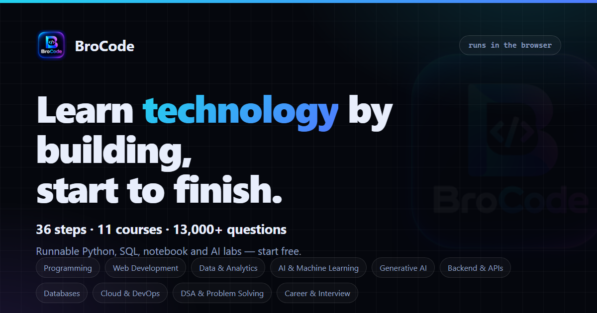

<p align="center">
  <a href="https://mybrocode.vercel.app/">
    
  </a>
  
</p>

<h1 align="center">BroCode</h1>

<p align="center">
  <strong>The complete technology learning platform.</strong><br />
  Learn the theory, run the code, practise the questions, and prepare for the interview — in one browser tab.
</p>

<p align="center">
  <a href="https://mybrocode.vercel.app/"></a>
  <a href="https://github.com/ashu018019020-collab/BroCode"></a>
</p>

<p align="center">
  
  
  
  
  
  
</p>

<p align="center">
  <a href="https://mybrocode.vercel.app/">
    
  </a>
</p>

## What is BroCode?

**BroCode** is an online learning platform for programming, data, AI/ML, and interview preparation. It turns a single authored curriculum into one connected journey: **Learn → Code → Practice → Build → Master**.

It is not a video library. It is a learning intelligence system: every lesson has code you can run, every topic has questions you can practise, every stage has a project to build, and every mistake is tracked so you actually improve. Accounts are required to open the platform — there is no guest mode.

**At a glance**

| | |
|---|---|
| Curriculum | 29 chapters across 8 learning tracks, organised as 11 courses / 36 numbered steps |
| Question bank | 13,865 questions across 29 chapter banks (interview, coding, debug, logic, theory, solved, defense, checkpoint) |
| Drills & mocks | 476 playbook items, timed exams, and 39 mock-interview questions across 4 rounds |
| Interview Room | 8 subjects, 6 round types, 3 difficulty levels, voice questions, answer transcription, AI evaluation, session report |
| Runtime | Python 3.12 + NumPy + pandas, SQLite, pdf.js — all bundled, no CDN |
| Language | English by default, Hinglish available |

## Quick links

| Link | What it opens |
|---|---|
| [Live demo](https://mybrocode.vercel.app/) | The deployed platform |
| [Interview Room](https://mybrocode.vercel.app/#/interview-mode) | Pick a subject, configure a round, start |
| [Practice](https://mybrocode.vercel.app/#/practice) | Tracks → chapters → question bank |
| [Question Bank](https://mybrocode.vercel.app/#/questions) | Every stored question, filterable |
| [AI Mentor](https://mybrocode.vercel.app/#/ai-mentor) | Voice-first mentor and coding coach |
| [Notebook Lab](https://mybrocode.vercel.app/#/notebooks) | Jupyter notebooks on the bundled Python runtime |
| [Career](https://mybrocode.vercel.app/#/career) | Job-readiness gates, resume answers, next action |
| [Docs](docs/) | Architecture, security, authentication, content pipeline, voice |

## Core experience

### 8-pillar learning navigation

The sidebar *is* the learning journey: **Dashboard → Learning → Practice → Labs → Projects → Interview → Career → Progress**, plus a **Tools** group (Notes, Cheat Sheets, PDF Reader, Settings). Each pillar is a hub page that indexes the real screens behind it, and every card shows a figure from the engine or manifest that owns it — no marketing numbers.

### Jupyter notebooks everywhere

Coding practice across every lesson stage (Learn, Coding Lab, Debug, Mini Project, Project Lab, Final Assessment) happens in a notebook panel:
- Cells share **one kernel session per notebook**, and imports carry down the page
- Real stdout, `In [n] / Out [n]` numbering, and a live **kernel-variable panel**
- A failing cell opens an **Errors tab** with an AI explanation and a progressive hint ladder (optional Hinglish), and can file the failure straight into the **Mistake Tracker**

### AI Python Learning Studio (Code Playground)

A VS Code-style IDE: Monaco editor, file explorer, program input, output console, local AI tutor, and an honest package manager, running real Python in the browser through a bundled Pyodide with NumPy + pandas.

### Error intelligence

Tracebacks are parsed to file / line / column, the exact line is highlighted, and a teaching card explains the mistake in clear English (optional Hinglish), with hints and a one-click **Fix It** where derivable.

### Dashboard + roadmap

8 tracks (Python Core → Interview + Projects) mapped onto 29 sections, with prerequisite gates, XP and levels, streaks, daily mission, mistake tracker and spaced review.

### English-first, Hinglish-ready

English is the permanent default; the app never guesses from the browser language. Hinglish is an explicit, optional choice, saved locally, and missing translations always fall back to English.

### Runs locally, ships as a static build

Monaco, icons, fonts, the Python runtime, the SQL engine, datasets and the PDF are all bundled. The optional account, the one-time AI voice download and hosted evaluation are the network features, and each says so in the UI.

---

## Tech Stack

<div align="center">


</div>

**Runtimes:** Pyodide · sql.js · pdf.js  
**Offline cache:** Service Worker (PWA, cache `aiml-v6`)

---

## Quick Start

**Requirements:** Node.js 18+ (LTS 22 recommended — a one-time install that needs internet), and a modern browser (Chrome / Edge / Firefox).

```bash
npm install
npm run dev        # http://localhost:5173
```

Production:

```bash
npm run build
npm run preview    # http://localhost:4173
```

For a plain static host (nginx / IIS / USB stick), serve the `dist/` folder after `npm run build`. Diagnostics:

```bash
npm run doctor     # ✓ ready · ⚠ warning · ✕ missing
```

To sign in, copy `.env.example` to `.env` and fill in the Supabase values. Without them the app is **unconfigured by design** — it says sign-in is unavailable rather than granting access without a session.

---

## Project Structure

| Path | What it is |
|---|---|
| `src/app/` | Shell: `App.tsx` (routes + sidebar `NAV`), `main.tsx`, `i18n/` |
| `src/core/learning/` | Mastery gates, roadmap, spaced review, coverage counts, study log, Learning Path registry |
| `src/core/assessment/` | Rubrics, output checks, exam papers, interview scoring, accuracy |
| `src/core/ai/` | Local assistant: page-aware retrieval, tutor hints, progress coaching, strict app facts |
| `src/core/platform/` | `keys.ts` (persisted-key shapes), command palette, notifications, achievements |
| `src/core/storage/` | `store.ts`: single owner of `AppState`, the only module touching `localStorage` |
| `src/core/data/` | Loaders/adapters for curriculum, questions, playbook, notebooks, tracks, AI index |
| `src/features/` | Screens grouped by pillar: dashboard, learning, practice, labs, projects, interview, career, progress, tools |
| `src/components/` | Shared UI, editors (MonacoIDE, JupyterNotebook), card grids (PathGrid, HubGrid) |
| `content/` | Authored source: curriculum, guides, packs, topics, question banks, playbook, notebooks |
| `public/generated/` | Build output from the scripts (incl. `ai/knowledge.json.gz`), never hand-edited |
| `scripts/`, `tools/` | Generators (dry-run by default, `--write` publishes) and the test suite |

---

## Offline Runtimes

| Capability | Bundled runtime |
|---|---|
| Python 3.12 + numpy + pandas | `public/pyodide` (WASM + filtered wheels, ~48 MB) |
| SQL (SQLite) | `sql.js` WASM in `public/sqljs` |
| PDF reader | `pdf.js` + worker in `public/pdf/` |
| Curriculum + search | `public/generated/curriculum/*.json` |
| BroCode AI knowledge | `public/generated/ai/knowledge.json.gz` (local retrieval only) |
| Datasets | students, sales, customers, employees, expenses, chat_logs |

A service worker (`public/sw.js`, cache `aiml-v6`) caches the app shell at runtime. After the first full load, a reload is served from that cache when the network is slow or unavailable. Install as a **PWA** from the browser menu for a standalone window. It is a **local** runtime, not a "works completely offline" claim — signing in and the optional hosted AI features still need a connection.

- Refresh the assistant corpus: `npm run ai:index` (dry run) / `npm run ai:index:write` (publish). No hosted model, no learner records.
- The service worker never caches HTML under asset paths (no poisoned cache).
- GenAI / Agentic labs are deterministic **in-browser simulations**. Any optional online feature is clearly labelled where it appears.

**Python runtime:** nothing to set up; first run takes ~30–60 s to unpack, then it is cached. `input()` reads from the "Program input" box (one value per line).  
**SQL runtime:** nothing to set up; `sql.js` loads its `.wasm` from `public/sqljs`.

---

## AI Mentor, Coding Coach & Spoken Interview

The AI studio at `/#/ai-mentor` adds a voice-first mentor, a diagnostics-driven coding coach inside the Playground, and a spoken mock-interview round with scorecards. Answers, code evidence and scores come from the bundled curriculum and the offline runners.

The spoken voice is **Supertonic 3**, a 99M-parameter multilingual TTS model that runs inside the browser through ONNX Runtime Web: Hindi and English, no API key, no server, audio never leaves the device. It is a one-time ~398 MB download, started by a button that states the size, cached on the device; until it is loaded (and if it ever fails) the built-in browser voice reads answers and the UI says which engine spoke. Optional OpenAI Realtime voice needs a server-side key, is rate-limited, and is a separate path. Details: [docs/AI-VOICE.md](docs/AI-VOICE.md).

---

## Roadmap

**What is already built**

- Offline-first learning IDE with notebooks, SQL and PDF reader
- 29-chapter curriculum across 8 tracks, with mastery gates and spaced review
- 13,865-question bank: every answer is one record shared across every surface
- Local AI mentor with progressive hints and error explanations
- Interview engine with mock and spoken rounds, AI evaluation, and a session report
- Mistake tracker, spaced review, XP and streaks
- Career readiness, resume answers, project defense, and portfolio selection
- Account sign-in and progress sync

**What is planned**

- Real-time sign up / login with Google + GitHub
- Per-user personalized dashboards
- Deeper AI specializations
- Mentorship-driven projects
- Certification tracks
- A developer community

These are intentions, not shipped features.

---

## Maintainer Guide

<details>
<summary><b>🌐 Language system</b></summary>

English is the official default; the app never guesses from the browser language. The English | Hinglish switch (Settings and the quick-actions menu) changes the UI in place and stores the choice.

`src/app/i18n/` holds `locales.ts` (English + Hinglish dictionaries) and `index.tsx` (`I18nProvider`, `useI18n().t`, persistence, English fallback). To add strings: add the key to `en` first, then translate in `hinglish`. Lesson prose is PDF-authored and translated in reviewed batches (see [docs/LOCALIZATION-GUIDE.md](docs/LOCALIZATION-GUIDE.md)).
</details>

<details>
<summary><b>📦 Adding offline packages & lessons</b></summary>

**Packages:** edit `src/core/data/packages.ts`. `availableOffline: true` only for packages truly bundled (numpy, pandas, stdlib). Everything else stays `false`.

**Lessons:** the curriculum lives in `content/curriculum/` and is published to `public/generated/curriculum/sections.json` (generated from the PDF by `tools/extract.mjs`). The app renders whatever the schema contains — no page changes needed.
</details>

<details>
<summary><b>❓ Authored practice packs & question banks</b></summary>

Two layers: `source: "curriculum"` (extracted from the PDF) and `source: "authored"` (hand-written in `content/questions/expansion/*.json`, short keys `s/t/d/i/q/a/x`). Authored records carry `sourceVersion`, `verifiedAt`, a track tag and a batch id like `track:sql:v1`.

Types: `theory`, `interview`, `coding`, `logic`, `debug`, `solved`, `defense`, `checkpoint`.

```bash
npm run questions:expand-track -- --track=sql --file=content/questions/expansion/sql.json
npm run questions:quota                 # per-track × per-type quota gate
npm run questions:quota -- --report     # regenerate CONTENT-REPORT.md
```

`questions:expand-track` is append-only and idempotent. `questions:quota` expects +20 items of every type in every track (8 × 8 × 20 = 1,280).
</details>

<details>
<summary><b>📘 "CODE KAISE KARTE HAIN" guide layer</b></summary>

Guides live in `content/curriculum/guides/<track>.json`, measured against `content/curriculum/topics/<track>.json`.

```bash
npm run curriculum:guides         # dry run: validate + execute every example
npm run curriculum:guides:write   # apply into sections.json
npm run curriculum:topics         # required-topic coverage matrix
```

Every example runs with the local Python interpreter and stores real stdout. Examples needing bundled-only modules keep documented output and are marked `verified: false`. Guides are additive and never overwrite extracted PDF notes. Run this pass after `curriculum:learn:write` / `curriculum:stages:write`.
</details>

<details>
<summary><b>📓 Jupyter notebooks (content/notebooks)</b></summary>

Real `.ipynb` files, runnable in the Notebook Lab (`/notebooks?nb=<file>`), inline in lessons, and from the Learning Path, all on the offline Pyodide runtime. Each notebook has its own kernel session.

```bash
npm run notebooks          # dry run: validate + execute every cell
npm run notebooks:write    # execute, stamp real stdout, publish to public/notebooks/
npm run notebooks:check    # structure matrix
```

Cells that teach an exception declare `metadata.expectError: true`. Cells needing numpy/pandas declare `metadata.appOnly: true` and are marked `verified: false`. Nothing is fabricated.
</details>

<details>
<summary><b>🧩 16-part topic workspaces</b></summary>

Every section can carry a topic workspace (`section.topic`):

1. Introduction · 2. Concepts · 3. Syntax · 4. Simple examples · 5. Real-world examples · 6. Interview questions · 7. Practice (5 levels) · 8. Coding practice · 9. Debugging · 10. Challenges · 11–13. Simple / medium / hard projects · 14. Project improvements (V1 → V4) · 15. Interview-based practical tasks · 16. Revision checklist

Sources: `content/curriculum/packs/<sectionId>.json`.

```bash
npm run packs -- --section=s08   # dry run
npm run packs:write              # apply
npm run packs:check              # 16-part quality matrix
```

The pass refuses to write on duplicate questions, missing parts, or dishonest snippets (runnable must run, broken must fail, logic bugs must differ from their fix).
</details>

<details>
<summary><b>🔄 Regenerating curriculum & importing the V10 answer PDF</b></summary>

```bash
node tools/extract.mjs "<path-to-pdf.pdf>"                  # writes public/generated/curriculum/*.json
npm run questions:pdf -- --pdf="<path-to-v10.pdf>"          # dry run
npm run questions:pdf:write -- --pdf="<path-to-v10.pdf>"    # merge + rewrite manifest
```

Source: a 457-page guide (29 sections, 163 concepts, 179 interview Q&A, 245 coding tasks, 172 logic cards, 120 solved practices, 29 mini projects, 87 project-lab tiers, 20 checkpoint questions, 39 mock-interview questions, 60 cross-skill questions).

The V10 import (3,239 pages, 13,582 items) is a **dry run by default**, deterministic and idempotent. Difficulty maps BASIC→easy … SENIOR→expert; importance maps CRITICAL→must_know, HIGH→high_value, CORE→advanced. Duplicates are removed, never hidden. Every record keeps `pdfPage`, `pdfStage`, `pdfImportance`. The PDF itself is not committed.

**Stage slices in lessons:** LEARN → theory, INTERVIEW → interview, CODING LAB → coding, LOGIC → logic, DEBUG → debug, Practice Solutions → solved, MINI PROJECT → `mini-project` tag, DEFENSE → defense, CHECKPOINT → checkpoint. The mapping lives in `STAGE_QNA` in `src/core/data/questions.ts`; `StageQnA.tsx` renders it and shares `qb:<id>` attempt keys with the Question Bank.
</details>

---

## Data & Backup

- Progress, XP, streak, attempts, mistakes, notes, bookmarks, saved code: `localStorage` (`aiml:state:v1`, versioned)
- Large blobs use IndexedDB. **Nothing leaves your machine.**
- **Settings → Export progress** saves `aiml-progress.json`; Import restores everything.

---

## Troubleshooting

| Problem | Fix |
|---|---|
| Python says "Loading…" forever | First boot is slow. Run once online so the service worker caches the runtime. |
| SQL shows a wasm / MIME error | Ensure `public/sqljs/sql-wasm-browser.wasm` exists and is served as `application/wasm`. |
| App won't load from cache | Load fully once online; check the SW in DevTools → Application → Service Workers; clear any old `aiml-v1` cache. |
| Hard reset | Settings → reset, or delete the `aiml:state:v1` localStorage key. |
| AI feedback says "Built-in rubric" | No `OPENAI_API_KEY` on the API server — this is the honest fallback, not a failure. |
| Microphone button is disabled | The browser has no Speech Recognition (non-Chromium); type the answer instead. |
| Offline stack traces / screencasts required by distributors | The product has no telemetry and no pre-recorded media. Provide the live demo link and the source, not a recording. |

---

## Creator

**Created by [Ahetesham Khan (Ashu)](https://github.com/aheteshamkhan).**

[](https://ahetesham-portfolio.vercel.app/)
[](https://github.com/aheteshamkhan)
[](https://www.linkedin.com/in/ahetesham-khan-b3a35a3b5/)

**[⭐ Star this repo](https://github.com/ashu018019020-collab/BroCode)** if BroCode helps you learn.

---

<div align="center">
  
</div>
